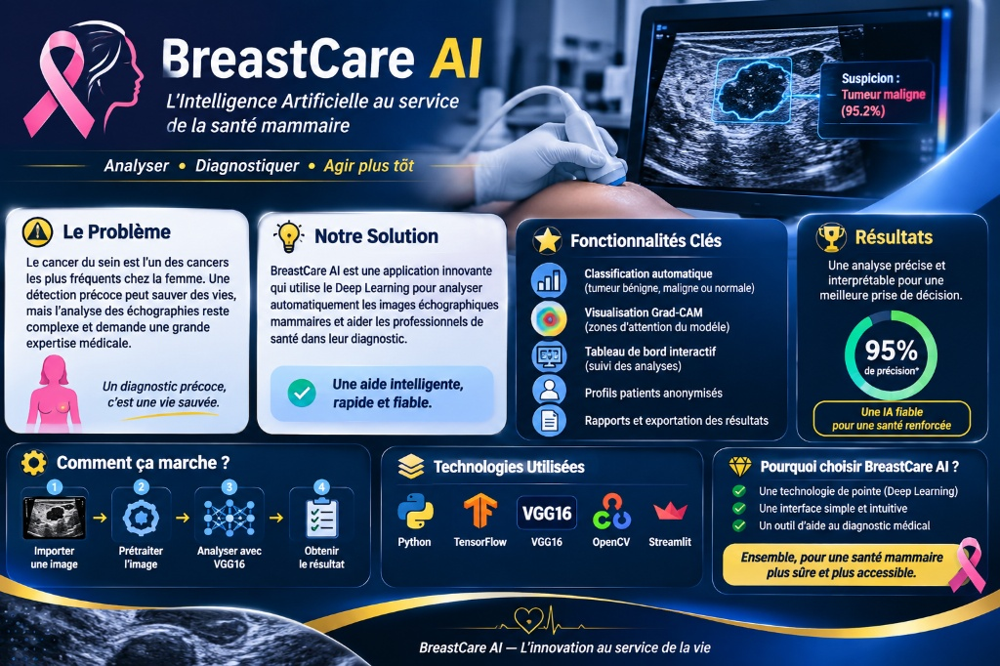

# 🩺 BreastCare AI
### *L'Intelligence Artificielle au service de la santé mammaire*

**Analyser · Diagnostiquer · Agir plus tôt**

[Lien vers l'application: https://breastcare-ai-psmgynlbsjyfjin5rbltfm.streamlit.app//]

## 🎯 Présentation pour les Recruteurs

**BreastCare AI** est une plateforme web expérimentale conçue pour démontrer l'application concrète du **Deep Learning** et de l'**Intelligence Artificielle Explicable (XAI)** dans le domaine de l'imagerie médicale. 

Ce projet met en valeur la capacité à transformer un modèle complexe de vision par ordinateur en une **application métier complète, ergonomique et orientée utilisateur**, pensée pour accompagner les professionnels de santé.

---

## 💡 Le Problème & Notre Solution

* **Le Défi :** Le cancer du sein est l'un des cancers les plus fréquents chez la femme. Si une détection précoce sauve des vies, l'interprétation des images échographiques reste complexe et exige une expertise médicale pointue.
* **La Réponse BreastCare AI :** Une interface intuitive qui analyse automatiquement les échographies mammaires grâce au réseau de neurones **VGG16**, fournit une classification en trois catégories (*Tumeur bénigne*, *Tumeur maligne*, *Image normale*) et éclaire la décision grâce à la visualisation **Grad-CAM**.

---

## ✨ Fonctionnalités Clés de l'Application

### 1. 🔬 Analyse Intelligente & Explicabilité (Grad-CAM)
L'utilisateur importe une image échographique et obtient instantanément :
* La **classe prédite** par le modèle accompagnée de son **score de confiance** présenté sous forme de graphique en anneau interactif.
* Une **carte thermique Grad-CAM** superposée à l'image originale, permettant de visualiser précisément les zones qui ont influencé la décision de l'IA.

### 2. 👥 Gestion des Dossiers Patients Anonymisés
Un espace dédié permet de créer des fiches patientes anonymisées (identifiant unique, âge, date d'examen, médecin opérateur) et de documenter l'avis clinique du professionnel de santé.

### 3. 📊 Tableau de Bord Hospitalier
Une vue synthétique regroupant les indicateurs essentiels : nombre total de dossiers enregistrés, dossiers revus, analyses en attente de validation médicale et répartition des classes prédites.

### 4. 📄 Rapports & Exportation
Possibilité d'exporter l'ensemble du registre des analyses au format **CSV** pour le suivi statistique, ainsi que de générer des **rapports individuels imprimables** pour chaque patiente.

---

## 🧠 Technologies & Savoir-Faire Mobilisés

* **Intelligence Artificielle & Vision par Ordinateur :** Architecture **VGG16** (TensorFlow / Keras) et explicabilité visuelle **Grad-CAM** (OpenCV).
* **Interface & Expérience Utilisateur (UX/UI) :** Application web interactive développée avec **Streamlit**, enrichie d'un design sur mesure et de graphiques **Vega-Lite**.
* **Traitement & Gestion de Données :** Manipulation d'images médicales et structuration des données cliniques avec **Python**, **NumPy** et **Pandas**.

---

## ⚠️ Cadre Éthique & Limites

> **Prototype académique et de recherche :**  
> BreastCare AI est un outil expérimental. Les scores affichés sont des sorties brutes du modèle d'intelligence artificielle et **ne constituent en aucun cas un diagnostic médical validé**. L'application a pour vocation d'illustrer le potentiel de l'IA comme outil d'aide à la décision et nécessite une validation clinique et réglementaire avant tout usage hospitalier réel.
